<div align="center">

# StarMap 星图

**内网资产测绘与账外资产发现引擎**

> 被动感知网内流量，自动测绘资产拓扑、登记主机资产、发现账外设备，对可疑行为**只打标签、不定性**。

**当前版本 1.3.1**（[1.3.1 发布说明](docs/RELEASE-1.3.1.md) · [1.3.0](docs/RELEASE-1.3.md) · [1.2](docs/RELEASE-1.2.md) · [1.0 上线就绪度评估](docs/RELEASE-1.0.md) · [CHANGELOG](CHANGELOG.md)）

[](https://go.dev)
[](LICENSE)
[]()
[]()
[]()
[]()
[]()

</div>

---

> [!WARNING]
> **默认不启用认证。** StarMap 的定位是内网工具：默认只监听 `127.0.0.1:8080`，且不自建账号体系
> （合规裁定 K1，见 [AUTH-APSSO.md](docs/AUTH-APSSO.md)）——**启动即可读写全部数据**。
>
> 在把它接到任何非受信网络之前，至少做以下之一：
>
> 1. **前置反向代理做认证**，并配置 `trusted_proxies`（不配的话审计日志里所有操作人都会是代理 IP，登录限流也会把全网用户当成一个人）；
> 2. **启用内置账号体系**：`auth.mode: local`（本地账号 + bcrypt）或对接 OIDC。
>
> 这是有意的默认值，不是疏漏——内网单机部署时先要求配账号，多数人会直接放弃。前提条件与威胁模型写在
> [docs/SECURITY.md](docs/SECURITY.md) 的「2.1 默认无认证」与「8. 已知风险」两节，提交安全 issue 前请先读那两段。

---

## 这是什么

StarMap 星图是一个部署在**内网**的资产测绘系统。它通过三路数据被动感知网络流量，自动生长出资产拓扑与主机台账，把"网络里到底有哪些设备、哪些是台账之外的影子设备"这一基本问题持续回答清楚。

核心价值是**账外资产发现**：企业在册资产台账之外，往往还散落着未登记的主机、测试机、旁路设备。StarMap 通过流量自动发现这些设备，**导入人工台账做三方对照**，让"账实不符"一目了然：

| 分类 | 含义 |
|---|---|
| 在册在网 | 台账有、网内也有（账实一致） |
| **台账外设备** | 网内有、台账没有 —— 影子设备，核心价值 |
| 台账僵尸 | 台账有、网内从未发现（报废未下账 / IP 填错） |
| IP 不符 | MAC 对得上、IP 与台账不同（DHCP 变更、私自改地址） |

## 设计原则

- **被动优先**：以流量发现为主（PCAP 导入 / 网卡抓包 / 远端探针上报），主动探测为辅。
- **只打标签，不定性**：对可疑行为仅产出特征标签（如"疑似 FRP 隧道特征"），不判定"违规/违法"，不告警外发，不联动封禁。
- **单二进制，离线可用**：纯 Go + SQLite（免 CGO），前端资源 `embed` 内嵌，无任何 CDN/外网依赖，内网一键部署。
- **不自建账号与权限体系**：无用户表、无权限管理界面、无资源级 ACL。可外接 OIDC 身份源（如 APSSO）做可选门卫，默认关闭；门卫只做 `viewer`/`operator`/`admin` 三级**写操作**收敛，读数据对所有角色一致开放。

## 功能特性

### 流量驱动的资产发现

- **三路数据接入**：PCAP/PCAPNG 离线导入、多网卡实时抓包（`-tags pcap`）、**独立探针上报**（单文件、无 CGO），统一汇入同一流水线。
- **拓扑自动测绘（自生长）**：同 MAC 多 IP 合并、`/24` 子网聚合（可下钻）、公网按 `/24` 聚合为外部节点、边老化灰度、降噪、NAT 修复。
- **异常不隐藏（风险锚点）**：中/高风险节点不参与网段聚合，始终单独呈现（红色虚环）；跨网归属另画虚线归属边，双归属主机会同时连到两个网段聚合节点——**一机两网在拓扑上直接可见**。
- **七层转发还原（XFF）**：经 nginx / HAProxy / SLB / API 网关转发的请求，被动侧只看得到代理 IP；解析 `X-Forwarded-For` / `X-Real-IP` / RFC 7239 `Forwarded`，把**代理背后被遮蔽的真实客户端**还原成独立节点（紫色虚线表示"经代理转发"），代理节点不参与聚合。这些客户端同样进入资产库与台账对照。
- **自动发现（可选）**：周期对目标网段做 ARP/ICMP 扫描，让拓扑持续生长；开启 `auto_discovery_follow_discovered` 后**自动跟随流量发现的新网段**（受排除列表与单轮上限约束，防扫描面失控）。默认关闭。
- **网段清单**：一览全部已发现内网网段（主机数 / 在线 / 网关 MAC / 探针位置 / 最高风险），支持一键下钻。
- **下钻即拓扑**：进入某个 `/24` 后完整保留网段内主机间链路，并补出其它聚合网段/外部 `/24` 作为上下文节点，看清"网段内谁连谁"与"这个网段往哪出去"。
- **探针位置归纳**：探针上报携带 `location`，节点归属位置，拓扑按位置分组为泳道。
- **主机资产库**：自动发现的主机登记为**未归档资产**，可人工归档登记归属单位 / 归属人 / 主机系统 / 位置；未归档主机离线超时自动清理（默认 72h，可配）。
- **台账对照（账实差异）**：导入人工登记的资产台账 CSV（列名中英文兼容、Excel 导出直接可用），与观测结果三方对照 —— 在册在网 / **台账外设备** / 台账僵尸 / IP 不符；台账外设备按风险排序，网段清单还按 /24 汇总"哪个网段影子设备最多"。
- **端口记录**：从流量五元组自动提取内网服务端口；可用**内置扫描**（不依赖 nmap）或调用系统 `nmap` 做主动扫描，双来源汇总，并带上服务指纹（产品 / 版本 / 标题 / 证书 / favicon）。

### 主动发现（1.2.0）

被动分析回答"网内有什么在通信"，主动发现补上"网内还有什么在监听"。这一块参考了灯塔（ARL）那套资产侦察的思路，
但**不引入 masscan / nmap 作为前提**——政务网运维机上常常装不上工具，装不上就归零不是可接受的答案。

- **内置 TCP 端口扫描**：纯 Go、纯用户态、无需 root、不需要任何外部命令。三档端口集：
  `quick`（约 100 个内网高价值端口，秒级）/ `standard`（1-1024 + 常见高位，约 1.1 千个）/ `full`（1-65535）。
  端口表自持而非沿用 nmap 的 top-ports——后者按公网服务频率排序，而内网真正有价值的是 445 / 3389 / 8080 / 3306 这些。
- **服务指纹**：把"端口开着"升级成"这个端口上跑的是什么"，四类证据互补：
  HTTP（状态码 / Server / 页面标题 / 跳转地址）、TLS（证书 CN / SAN / 签发者 / 到期日，能把一串 IP 还原成业务系统）、
  banner（SSH / FTP / SMTP / MySQL / Redis 等首包）、favicon mmh3 哈希（跨 IP 跨域名关联同一套系统的硬指纹）。
  内置 70 条规则，优先认**国产内网高价值目标**（泛微 / 致远 / 通达 / 用友 / 金蝶 / 深信服 / 海康 / H3C / 华为…），
  再退到通用 Web 服务器与中间件。宁可不给结论，也不给错误结论。
- **编排（先便宜后昂贵）**：先扫端口，只有真的开了端口才做指纹；指纹只挑最可能说明身份的端口
  （TLS > Web > 已知服务），单主机上限默认 32 个——对 65535 个开放端口各发一次 HTTP 请求，那是小型 DoS 而不是盘点。
- **限速优先于速度**：全局令牌桶默认 800 pps。政务网里一台老交换机被 5000 pps 扫过去会直接管理面失联，
  所以宁可慢，也不追求"最快扫完"。
- **能长期挂着的三重约束**：扫描时间窗口（支持跨夜 `22:00-06:00`）、失败指数退避（一台断电机器不该每轮重扫全端口）、
  已知主机降频（已在拓扑里的 IP 只扫高价值端口，把速率预算留给"从没见过"的地址——账外资产只可能出现在那里）。
- **发现即入账**：结果写入端口记录（含指纹）并让活跃主机进入拓扑，避免"资产列表里有、拓扑图上看不见"的割裂。
- **开关默认关闭**：端口扫描会在目标侧留下大量连接记录，与 ARP/ICMP 探活是两种授权风险，因此独立开关。

### 独立探针（1.4.0）

前面两块解决"看得见什么"，这一块解决"**怎么看得到**"：探针是一个约 14MB 的
单文件程序，扔在一台能看见流量的机器上就能跑，**不需要 gcc、不需要 libpcap、
不需要 Wireshark**。

- **四种采集后端，全都不碰 CGO**：Linux `AF_PACKET` 原始套接字（纯 syscall）、
  Windows 直连 `wpcap.dll`（纯 syscall，有 Npcap 就能跑）、`exec:` 任何往 stdout
  吐 pcap 的命令、`file:` 回放。`go build ./cmd/starmap-probe` 一条命令出单文件，
  四平台交叉编译全通。
- **只上报会话元数据**：五元组、字节数、SNI / HTTP Host / JA3 / JA4 / XFF，
  不上报任何载荷。所以可以铺很多个，而不用搬抓包文件。
- **会话聚合复用服务端同一套 `parser.Aggregator`**：探针算出的会话和服务端
  算出的必须一致——两套聚合逻辑必然分叉，最后表现为"探针有数据、规则不触发"，
  没有报错、只能人肉对数才能发现。
- **上报失败不丢数据**：有界离线队列 + 指数退避（1s→30s），服务端重启、网络
  抖动期间先攒着，超上限才丢最旧的并把丢弃条数打进日志。
- **收尾顺序是对的**：停采集 → 等读协程退出 → 冲会话增量 → 冲上报队列。
  反过来（先冲再停）会静默丢最后一段数据。
- **排障有抓手**：`-report 5s` 打 `frames / packets / sessions_sent / active`
  四个数，链路卡在哪一段一眼可见；`-dry-run` 不上报只验证采集；`-list-ifs`
  Windows 下按 **IP** 列网卡（描述为空的网卡也能选对）。

部署见 **[docs/PROBE.md](docs/PROBE.md)**；配置样例 `configs/probe.yaml`。

### 风险特征打标（仅标签）

| 规则 | 特征 | 等级 |
|---|---|---|
| `frp` | Go-TLS JA3/JA4 指纹 + 长连接保活 + 周期小包心跳（三中二 mid，三中三 high） | mid/high |
| `clash` | 随机高熵 SNI + 高频短间隔外联 + 持续陌生目的 | mid/high |
| `reverse_proxy` | 单内网 IP 映射 Host 数超阈值（默认 10） | mid |
| `unknown_egress` | 对外端口/链路数超 1h 滚动基线（带学习期） | mid |
| `multi_net` | 同节点/MAC/网关命中 ≥2 个网络域 | high |

### 可运营的闭环

- **复核闭环**：事件确认归档 / 误报自动加白 / 暂缓；白名单四维度（cidr/ip/host/node）命中即抑制。
- **网络域管理**：预置 gov/office/internet/prod 四域，CIDR 最长前缀匹配。
- **全量审计**：所有操作留痕（操作人 / 动作 / 对象），默认保留 90 天。
- **主动探测**：ARP / ICMP / Traceroute 跨平台（Linux + Windows），默认关闭。
- **可选门卫**：本地账号或 OIDC 单点登录（APSSO），`auth.mode = none|local|oidc`，默认 `none`；
  三级角色 `viewer < operator < admin` 只收敛写操作，读数据对所有角色一致。

### 运维可观测（1.1.0）

- **结构化日志**：标准库 `slog`，`text`/`json` 两种格式，`request_id` 贯穿访问日志与业务日志；
  默认级别可在「系统配置」里改，**立即生效**（不必重启）。
- **Prometheus 指标**：`/metrics` 导出 17 项指标（摄入包数、会话回收、检测轮次与耗时、
  拓扑节点/边总数、探针上报、HTTP 请求量与延迟直方图）。标签用路由模板而非原始 URL，防止标签爆炸。
  访问控制三档：`metrics_token` 直取 / `admin` 会话 / 其余 403，未启用时显式 404。
- **RBAC 三级**：角色来自外部身份源的 `roles`/`groups` 声明或配置文件，随会话 HMAC 签名下发；
  前端用 CSS 属性选择器收敛写操作入口，后端是唯一判定点——改 DOM 放出按钮也会被 403 拦下。

### 界面

设计基准与自家项目「刻本」同一套令牌（主色 `#3370ff`、画布 `#f6f7fa`、圆角 6/10、极克制的三档阴影），
56px 全局顶栏（品牌 + 全局搜索 + 身份胶囊）+ 浅色侧栏 + 页头 pill 标签的结构；
零外网依赖（图标全内联 SVG，无 CDN 字体）。

拓扑图为标准网管风格：设备图标 / 分层布局 / 正交折线 / 图例 / minimap / 右键菜单 / 导出 PNG·SVG / 双击下钻，
操作按钮全站统一置于页头右侧。

## 架构

```
                ┌────────────────────── StarMap（单二进制）──────────────────────┐
 PCAP 文件 ──►  │  ingest/pcapfile ─┐                                            │
 网卡抓包 ──►  │  ingest/capture  ─┼─► parser.Aggregator ─► topology.Engine ─┐   │
 远端探针 ──►  │  ingest/probe    ─┘   (五元组/MAC/SNI/  (节点/边/聚合/老化)│   │
                │                       Host/JA3/JA4)                       ▼   │
                │                                        detect.Detector（周期评估）│
                │                                          │ RiskEvent          │
                │                                          ▼                    │
                │                          review（复核）+ audit（审计）+ assets │
                │                                          │                    │
                │                    store（SQLite，modernc 纯 Go 驱动）        │
                │  web/（embed.FS 内嵌）◄── api/server.go（Gin REST /api/*）     │
                └────────────────────────────────────────────────────────────────┘
```

技术栈：**Go 1.26.10+ · Gin · gopacket · modernc.org/sqlite（免 CGO）· 原生 HTML/CSS/JS（零构建、零 CDN）**。

> Go 版本下限不是随手写的：低版本的标准库与 `x/net` 存在可被触达的已知漏洞，
> 当前 `govulncheck` 为 0 可达漏洞，CI 已把该项设为阻断。

## 快速开始

不想自己编译？[Releases](https://github.com/kinghtxg/starmap/releases) 里直接下载
`starmap-<os>-<arch>`（服务端）与 `starmap-probe-<os>-<arch>`（探针），
覆盖 linux/amd64、linux/arm64、windows/amd64、darwin/arm64。

```bash
# 构建（纯 Go，无需 CGO；版本号由 ldflags 注入）
CGO_ENABLED=0 go build -trimpath \
  -ldflags "-s -w -X starmap/internal/version.Version=1.4.0" \
  -o starmap ./cmd/starmap

# 查版本
./starmap -version

# 运行
./starmap -config configs/config.yaml
# 打开 http://127.0.0.1:8080

# 测试 / 竞态 / 覆盖率 / 模糊 / 性能（Linux、macOS 可用 make）
go test ./...
go test -race ./...                                # 需要 cgo（gcc）
go test ./... -coverpkg=./internal/... -coverprofile=coverage.out
go test ./internal/parser/ -run '^$' -fuzz=FuzzExtractForwarded -fuzztime=60s
go test ./internal/topology/ -bench=. -benchmem -run '^$'

# 静态检查（gofmt + vet + staticcheck；缺 staticcheck 会明确报错而不是跳过）
go install honnef.co/go/tools/cmd/staticcheck@latest
make lint

# 前端（发布前手动闸门，需 Playwright + msedge）
python scripts/ui-smoke.py      # 真浏览器跑导航 / 下钻 / 登录 / 角色门禁 / 分页搜索
python scripts/shot.py          # 采集 README 截图（顺带收集控制台错误）
make ci                                            # lint + race + coverage 一条命令
make release-check                                 # ci + ui，发布前完整闸门

# 生成合成 PCAP 测试数据（5 类场景 → testdata/out/）
go run testdata/gen_pcap.go

# 端到端验收（构建→起服务→上传 PCAP→断言事件/拓扑/复核/去重）
bash scripts/e2e.sh

# 探针验收：同一份 pcap 走"探针上报"和"直接上传"两条路，事件必须对得上
bash scripts/e2e-probe.sh

# 探针构建与试跑
go build ./cmd/starmap-probe            # 单文件，无 CGO
./starmap-probe -list-ifs               # 看网卡（Windows 显示 IP）
./starmap-probe -source auto -dry-run -report 5s -verbose   # 验证采集
./starmap-probe -config configs/probe.yaml                  # 正式上报

# 全功能 API 冒烟测试（需先启动服务）
python3 scripts/smoke_test.py

# Linux 一键部署（systemd）
sudo bash scripts/deploy.sh
```

> 实时抓包需 `-tags pcap` 构建并安装 libpcap/npcap。主动端口扫描需系统安装 `nmap`。

## 数据接入示例

**PCAP 导入**（页面 `ingest.html` 上传，或）：

```bash
curl -F "file=@testdata/out/frp_tunnel.pcap" http://127.0.0.1:8080/api/ingest/pcap
```

**探针上报**：用 `starmap-probe`（推荐，部署见 [docs/PROBE.md](docs/PROBE.md)）：

```bash
./starmap-probe -source npcap -iface "\Device\NPF_{...}" \
  -server http://192.168.31.100:8080 -location "核心交换机镜像" -config 可选
```

也可以自己写采集脚本，向 `POST /api/ingest/probe` 上报会话元数据，与抓包/PCAP 共用同一条流水线：

```json
{
  "probe_id": "probe-01",
  "ts": "2026-01-01T00:00:00Z",
  "flows": [{
    "src_ip": "10.1.2.3", "dst_ip": "10.1.2.4",
    "src_port": 40000, "dst_port": 443, "proto": "tcp",
    "bytes_up": 3000, "bytes_down": 8000,
    "sni": "www.example.com", "ja4": "t13d1516h2_..."
  }]
}
```

## 主要 API（`/api` 前缀）

| 方法 | 路径 | 说明 |
|---|---|---|
| GET | `/health` `/stats` | 健康检查 · 统计 |
| GET | `/topology` | 拓扑快照 |
| GET | `/topology/subnet/{cidr}` | 聚合子网下钻 |
| GET | `/assets` `/assets/stats` | 资产列表 · 资产统计 |
| POST/PUT/DELETE | `/assets/*` | 资产归档 / 维护 / 删除 |
| GET | `/ports` | 端口记录（流量 + 扫描双来源） |
| POST | `/ports/scan` | 主动端口扫描（nmap，异步） |
| POST | `/discover/run` | 主动发现：内置端口扫描 + 服务指纹（异步） |
| GET | `/discover/status/{id}` | 发现任务进度 / 结果 |
| GET | `/discover/plan` | 端口档位计划（要扫多少端口） |
| GET | `/events` | 事件列表（状态/类型筛选） |
| POST | `/events/{id}/review` | 复核（confirm / false_positive / defer） |
| GET/POST/PUT/DELETE | `/whitelist` `/domains` | 白名单 · 网络域 CRUD |
| POST | `/ingest/pcap` `/ingest/probe` | PCAP 上传 · 探针上报 |
| POST | `/probe/trigger` | 主动探测（arp/icmp/traceroute） |
| GET/POST/DELETE | `/ledger` `/ledger/import` `/ledger/clear` | 资产台账：列表 · 导入 CSV · 清空 |
| GET | `/ledger/diff` | 账实三方对照（在册在网 / 台账外 / 僵尸 / IP 不符） |
| GET | `/proxies` | 七层转发节点 + 背后真实客户端（XFF 还原） |
| GET/PUT | `/config` | 配置查询 / 热更新 |
| GET | `/audit` | 审计日志 |

## 截图

以下截图由 `scripts/shot.py` 在本机真实运行的服务上采集（数据来源：`testdata/out/` 的 5 个合成 PCAP
+ `testdata/simprobe.go` 模拟的政务网探针上报 + `testdata/ledger-sample.csv` 台账），
UI 设计基准与「刻本」同一套令牌。

| 拓扑总览 | 主机资产 | 风险事件 |
|---|---|---|
| 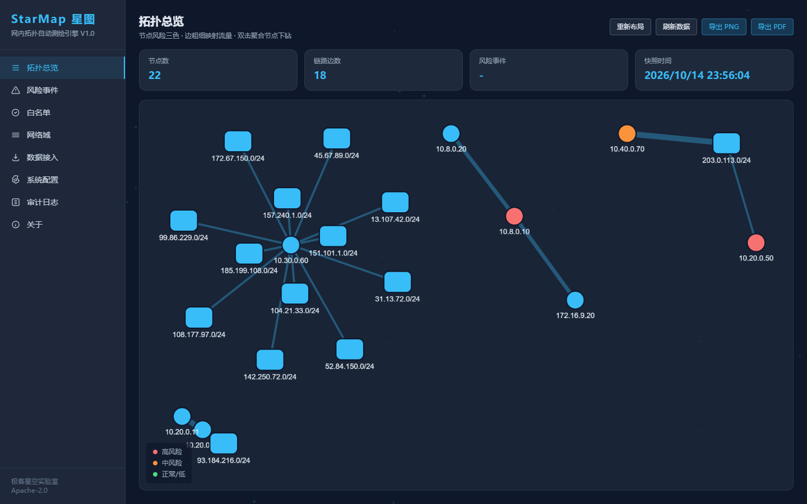 | 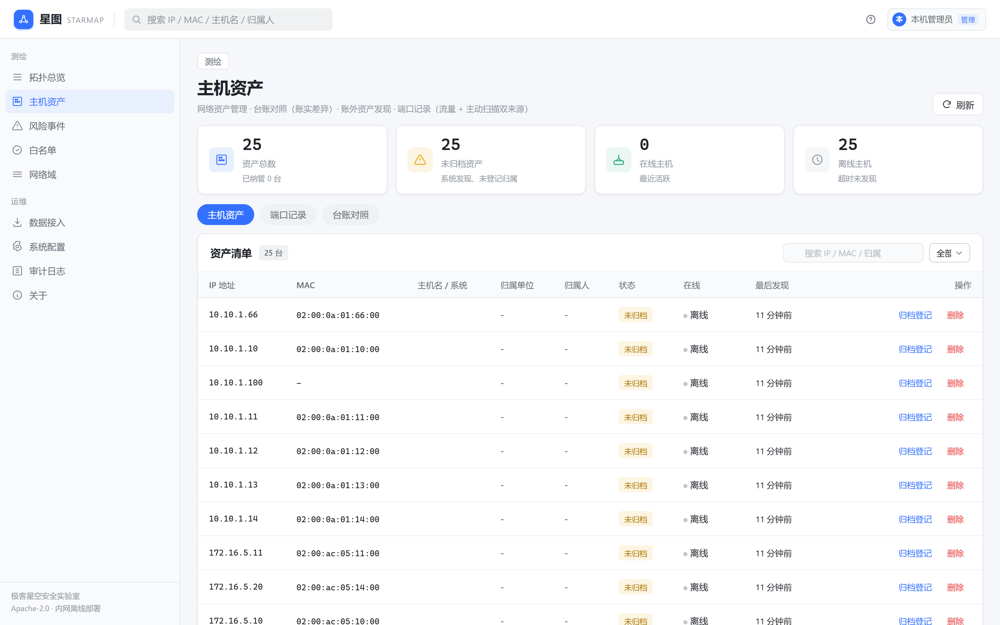 | 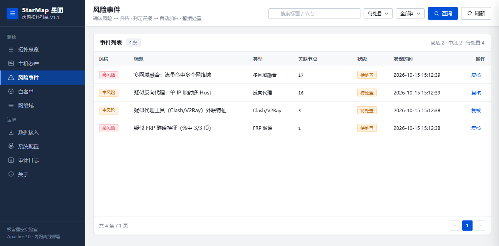 |

| 网络域 | 白名单 | 数据接入 |
|---|---|---|
| 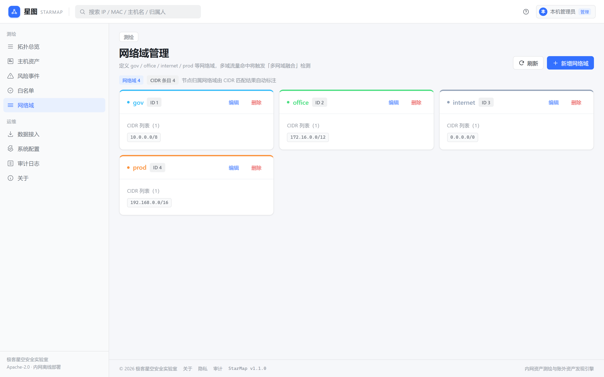 | 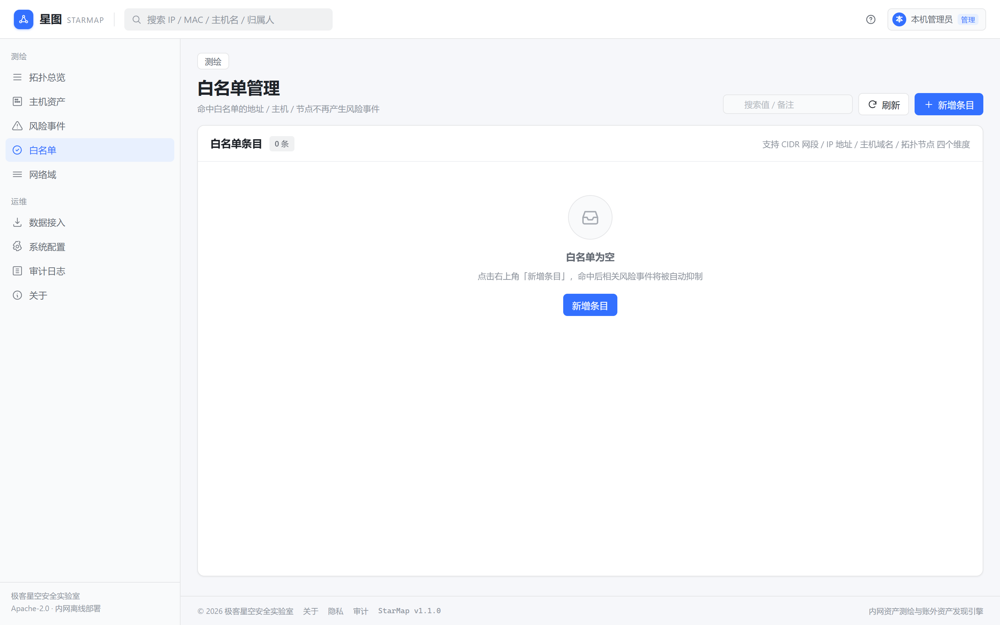 | 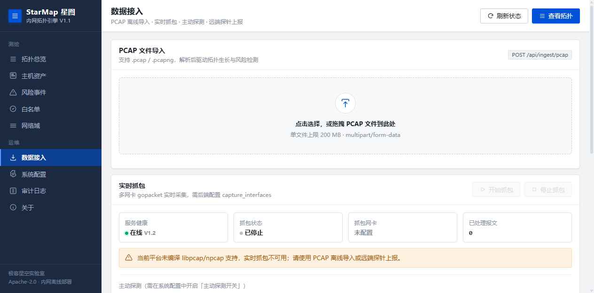 |

| 系统配置 | 审计日志 | 登录（可选门卫） |
|---|---|---|
| 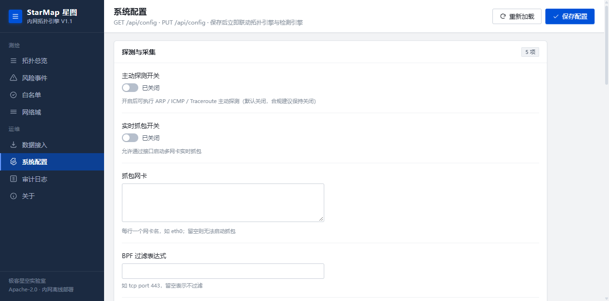 | 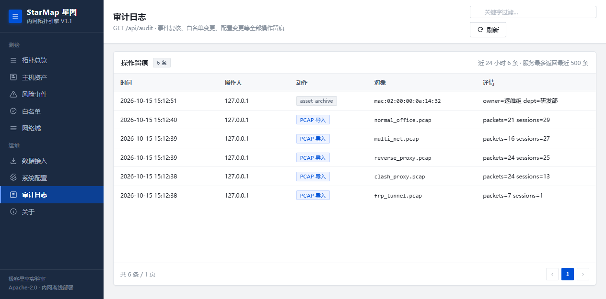 | 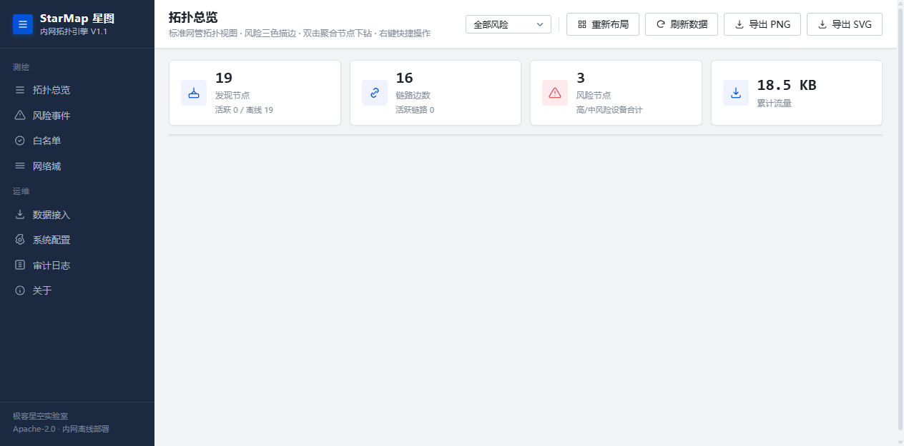 |

**下钻到某个 /24**：网段内主机间链路完整保留，并把其它聚合网段 / 外部 `/24` 补为上下文节点。
图中 `10.10.1.50` 是模拟的"一机两网"设备（红虚环 = 风险锚点，不参与聚合），
同时连着本网段与 `172.16.5.0/24`（细点线为归属边）：

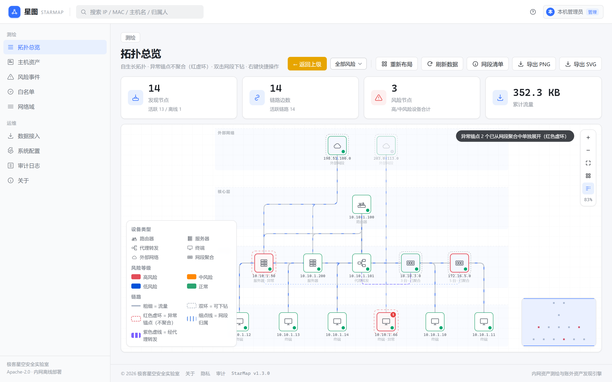

**台账对照**：导入 `testdata/ledger-sample.csv` 后的账实差异——9 条台账 vs 25 台实测主机：
在册在网 6 台、**台账外 18 台**、僵尸记录 2 条、IP 不符 1 条。台账外设备按风险排序，违规设备排在最前：

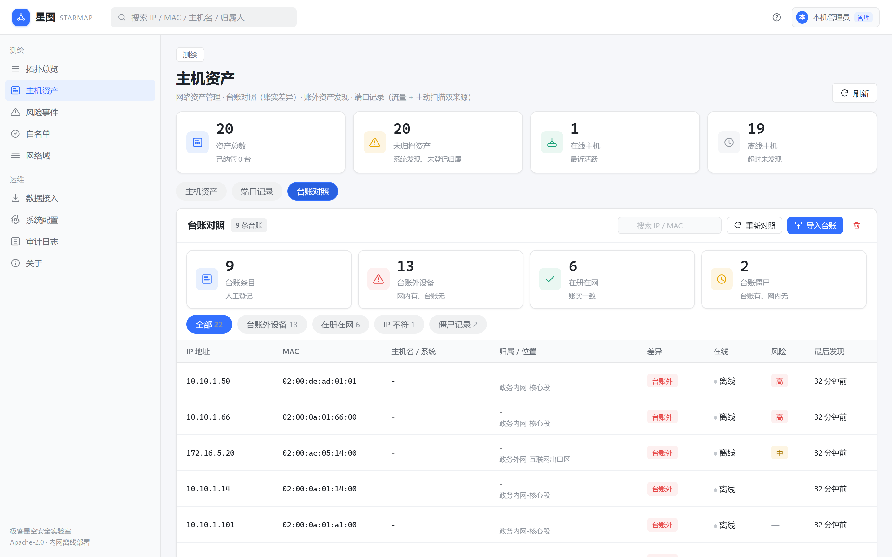

**七层转发还原**：`10.10.1.101` 是模拟的 nginx 反代，后端只看到它。解析 XFF 后，
背后 3 台客户端（`10.10.3.10-12`）被还原为独立节点，并以紫色虚线连到代理；
右侧详情同时列出"通信对端（经代理）"与"经 X-Forwarded-For 还原的客户端"：

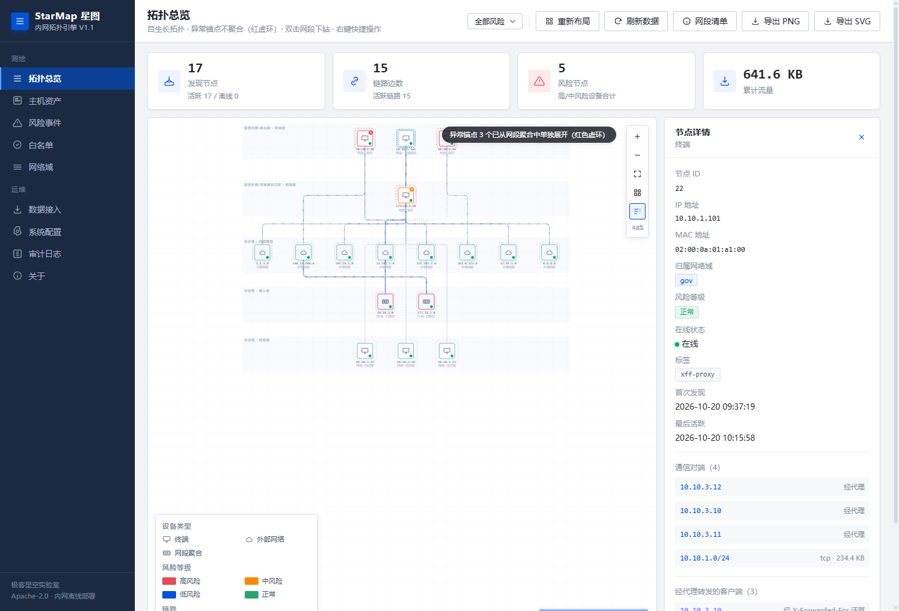

## 合规声明

- 对所有命中规则的流量**只打标签，不作定性结论**，不发送告警通知，不联动封禁。
- **不解密**任何加密流量：仅解析 TLS ClientHello 明文元数据（SNI / 密码套件 / 扩展）用于 JA3/JA4 指纹。
- 不内置漏洞扫描、IDS 规则匹配或攻击载荷；主动探测默认关闭，需显式开启。
- **请仅在获得授权的网络环境中使用。**

> JA4 指纹为按公开算法规范（FoxIO 的 JA4 方法学字符串格式）的自研实现，仅复用其指纹字符串结构，不使用其许可证约束的数据文件或代码，与 Apache-2.0 兼容。

## 文档

**先读这三份**（1.3.0 补齐）：
- [docs/ARCHITECTURE.md](docs/ARCHITECTURE.md) — **架构与实现详解**：每个功能怎么实现、代码在哪、为什么这么写
- [docs/OPERATIONS.md](docs/OPERATIONS.md) — **部署与运维手册**：反代、配置项全表、升级、监控、排障
- [docs/SECURITY.md](docs/SECURITY.md) — **安全模型**：威胁模型、信任边界、防护清单、部署方需承担的风险

其余：
- [docs/INTEL.md](docs/INTEL.md) — **威胁情报对接指南**（1.5.0）：推送样例、字段别名表、覆盖/乱序语义、回源契约
- [docs/PROBE.md](docs/PROBE.md) — **探针部署手册**（1.4.0）：四种采集后端、systemd/Windows 服务、权限、排障手册
- [docs/RELEASE-1.4.md](docs/RELEASE-1.4.md) — 1.4.0 发布说明（独立探针）
- [docs/RELEASE-1.3.1.md](docs/RELEASE-1.3.1.md) — 1.3.1 发布说明（真分页 / 配置一致性 / 收口）
- [docs/RELEASE-1.3.md](docs/RELEASE-1.3.md) — 1.3.0 发布说明（安全加固 / 容量护栏 / 文档）
- [docs/RELEASE-1.2.md](docs/RELEASE-1.2.md) — 1.2.0 发布说明（主动发现）
- [docs/RELEASE-1.0.md](docs/RELEASE-1.0.md) — 发布说明 + 上线就绪度评估 + 已知边界（部署前必读）
- [SPEC](SPEC.md) — 需求与数据模型规格
- [ACCEPTANCE](ACCEPTANCE.md) — 验收清单
- [CHANGELOG](CHANGELOG.md) — 版本变更（含每处修复的动机）
- [docs/AUTH-APSSO.md](docs/AUTH-APSSO.md) — 账号系统与 APSSO SSO 接入指南
- [docs/PM-DATA-INGEST-V2-DESIGN.md](docs/PM-DATA-INGEST-V2-DESIGN.md) — 数据接入 v2 产品设计

### 容量与运维要点

| 参数 | 默认 | 说明 |
|---|---|---|
| `session_max_count` | 200000 | 会话表硬上限；`/api/stats` 的 `Dropped>0` 说明打满 |
| `session_idle_seconds` | 300 | 会话静默多久回收；调太小会让慢速长连接反复上下线 |
| `session_max_age_seconds` | 21600 | 单会话最长存活，防不关闭的连接撑爆 |
| `aggregate_threshold` | 20 | 单个 /24 超过该主机数则聚合显示；大图调大 |
| `trusted_proxies` | 空 | 部署在反代后必须填，否则审计里的操作人全是反代 IP |
| `event_retention_days` | 180 | 事件保留期（只清已处置的）；此前完全没有清理策略 |
| `audit_retention_days` | 90 | 审计保留期；1.3 之前清理函数没有调用点，是"改了没用"的开关 |

舒适规模：**1 万节点 / 3 万边**（全量快照约 43ms）。超过后建议调大聚合阈值或改用网段下钻分区查看。

## 许可证

[Apache License 2.0](LICENSE) · © 极客星空安全实验室
