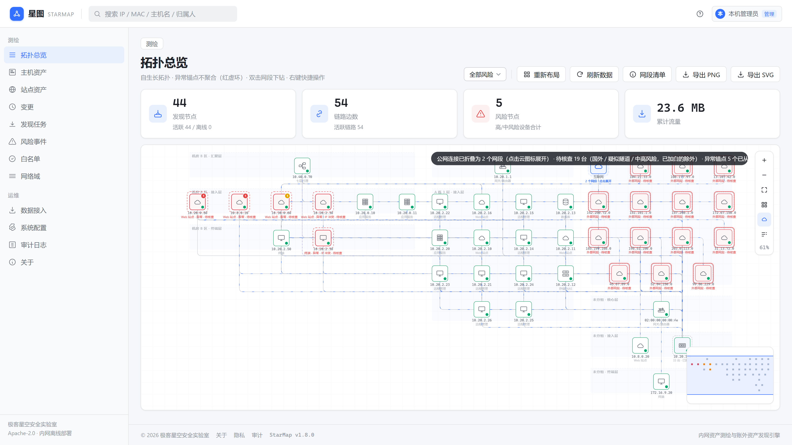
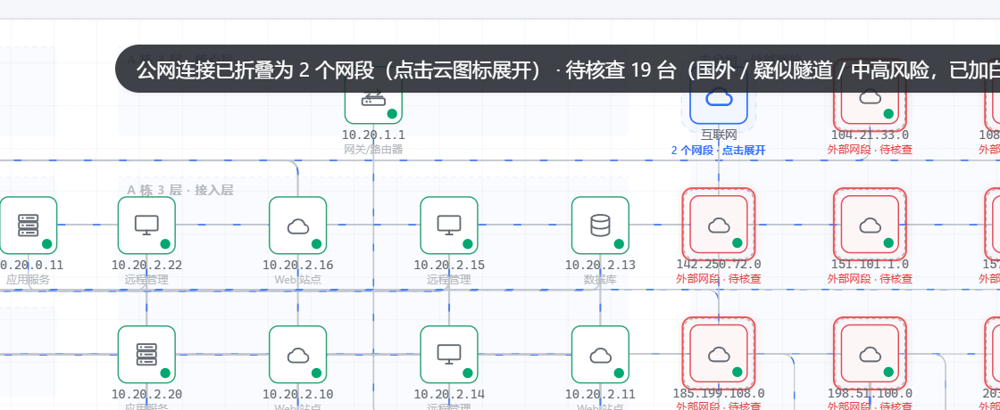
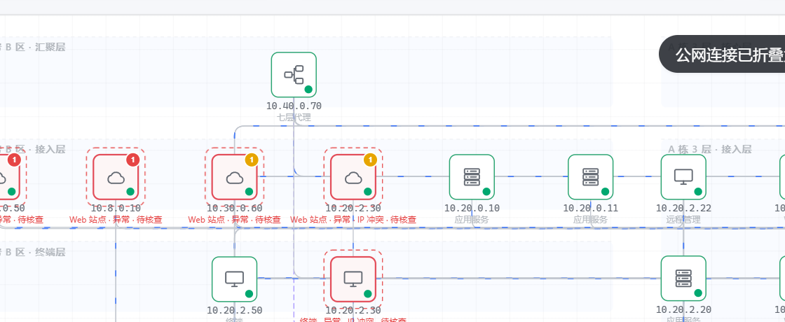

# 1.8.0 — 出口与代理：终于能说出"谁是路由器、谁在转发"

> 发布日期：2026-11-03 · 上一个正式版：1.7.2 · **无 schema 变更**，可直接替换二进制
> 完整版见 `docs/RELEASE-1.8.md`（本文件）；逐条实现细节见 [CHANGELOG](../CHANGELOG.md)。

## 这一版回答的问题

> **能不能发现路由器、NAT、网络出口和代理？**

答案是"能，但以前图上看不见"。这一版修掉四个真缺陷，并把"看得见"变成断言：
`internal/simnet` 新增 `egress` 与 `proxy` 两个世界，`test/truthcheck` 用一套
**不 import `internal/topology`** 的独立实现逐项比对。

| 现象 | 看起来像 | 实际是 |
| --- | --- | --- |
| 一台路由器在图上分成两行：`10.8.1.1` 和一台"只有 MAC 的空壳" | MAC 库没匹配上 | 网关的三条证据从不落在同一条会话上，谁先到谁建节点 |
| 接真实规模数据后出口设备消失，一堆主机直连公网 | 数据没录进去 | 网关在最大的 /24 里，被网段聚合一起折叠了 |
| 重启服务后网关不见了 | 重启丢了数据 | "谁是网关"只记在内存表 `gatewayMAC`，重启即空 |
| 全网流量必经的代理显示"未识别" | 没识别出来 | XFF 还原只打了标签、没给角色；前端也没有代理这一档 |

## 四个修复

**1. 同一台路由器被劈成两行。**
网关的 LAN IP 只在"别人连它"的会话里当**目的地址**；MAC 只在"它转发公网流量"的会话里当
**二层目的 MAC**。谁先到谁建节点，后到的证据只能另建一个，而按 IP 汇总的报表直接翻倍。

修法不是"事后合并节点"（要重写边、索引、端口、位置，风险远大于收益），而是
**创建时就把 IP 和 MAC 一起交进去**：同 /24 内网→内网会话的以太网目的 MAC 就是目的网卡的
MAC，作为 `nodeForLocked` 的提示走已有的"同 MAC 多 IP 合并"。**与证据到达顺序无关**。
守卫：跨网段不认（那是最后一跳路由器）；目的节点已有另一个 MAC 时不介入（那是 IP 冲突，
交给原有判定，不要在这里把两台机器合掉）。

**2. 网关被网段聚合吞掉。**
`visibleAsSelf` 原来只保护风险锚点与七层转发，现在加上"MAC 被至少一台主机当作首跳"。
判定必须用 `gatewayCountLocked()` 的结果、**不能用 `n.Role`**：聚合发生在角色推断之前。

**3. 重启后网关消失。**
`gatewayMAC` 是内存表，重启即空 → 判不出 → 又被聚合吞掉，**而重启那一刻恰恰是最需要看图的时候**。
把证据落成节点标签 `gateway` 随节点落盘，可见性与角色都以它为依据（角色判定用
"实时计数 **或** 持久证据"）。代价是标签单调——不再转发也会一直带着，这是有意的取舍：
误判成出口比漏判安全。

**4. 代理有标签、没有角色。**
新增 `RoleProxy`（七层代理/负载均衡），前端补 `ROLE_TYPE / ROLE_TIER / ROLE_LABEL`，
放进布局 BFS 的基础设施源——否则"网关在别处、只有代理在中间"的图会把代理排到终端层。

## 模拟器的三处保真度修正

它们直接决定"能不能测出问题"。**模拟器不真，测出来的"发现不了"就是模拟器的缺陷。**

1. **NAT 后的源 MAC 被当成"拿不到"**。SNAT 只改 IP 和端口，报文是从 NAT 设备自己的出口网卡
   发出去的——这是"出口地址"与"NAT 设备"能认成同一台机器的**唯一凭据**。旧断言一并改正。
2. **同网段目的 MAC** 新增 `Link.ViaMAC`：只有与源同网段的探针看得到二层。
3. **七层转发** 新增 `Link.ViaProxy`：只造服务端侧那一条会话（客户端→代理是另一条五元组）。

## 判据

- `egress`：网关+NAT+DNS 三合一。三条证据分别来自"别人连它""它自己发日志""它转发公网流量"，
  必须收敛成**一台设备、两个 IP、角色网关、每台主机到它都有边**。
- `proxy`：真实客户端只存在于 XFF 里，必须每台都在图上、带 `xff-client`、与代理之间有边。
- 新增 7 个变异测试（角色丢了、标签丢了、到网关的边删光、XFF 客户端丢了……），
  每一项都把实现弄坏确认会红。模拟器场景总数 8 → 10。

## 顺带修的两处

- **趋势按本地日期建桶**（此前取的是 UTC 日期，`substr(col,1,10)`，窗口查询偏 8 小时）。
  `strftime('%Y-%m-%d', substr(col,1,19), '<offset> seconds')`，偏移由 `now.Zone()` 传入，不写死 +8。
- **一个只在凌晨 0–1 点发作的测试缺陷**：趋势用例用 `now.Add(-time.Hour)` 造端口时间，
  凌晨时起始时间落到昨天，"今天的端口数"必然是 0。判据依赖"当前时刻"时，数据也得跟着走。

## 四个能力问题的实证结论

| 问题 | 结论 | 边界 |
| --- | --- | --- |
| **路由器 / 网关** | ✅ 1 节点 + `gateway` 角色 + 主机到它的边；聚合里不被吞；重启后仍在 | 需要至少一条"别人连它"或"它转发公网"的流量 |
| **NAT** | ✅ 出口地址与内网地址同 MAC → 合并成 1 台 | 跨 NAT 字节必然 2 倍，方法上限 |
| **网络出口** | ✅ 在首跳侧可见 | WAN 侧公网地址在局域网探针上不可见——部署位置决定 |
| **代理** | ✅ XFF 还原 + 关系边 + `proxy` 角色 | 依赖代理解析并下发 `X-Forwarded-For` |

没有为"验证一个拿不到的证据"去造 WAN 探针——造出来只会让校验器绿，现场仍然是黑的。

## 截图

-  — 网关独立站在核心层，办公网折叠成网段节点
-  — `10.20.1.1` 网关/路由器，主机到它有边
-  — `10.40.0.70` 七层代理，独立图标

## 升级

无 schema 变更，覆盖二进制即可。新增的节点标签 `gateway` **要等新流量进来才会出现**，
不会凭空补出历史网关。服务端与探针请成对升级。

部署方式（Windows / Linux / NAS / systemd / nginx 反代 / 探针 / 排障）见 [DEPLOY.md](DEPLOY.md)。
